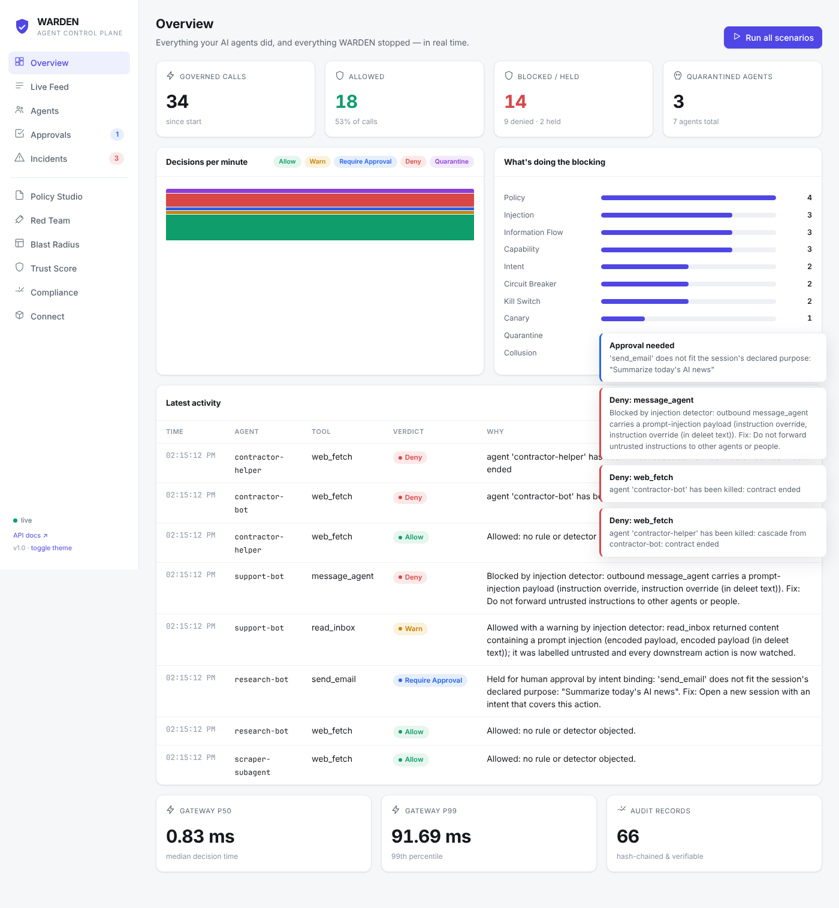
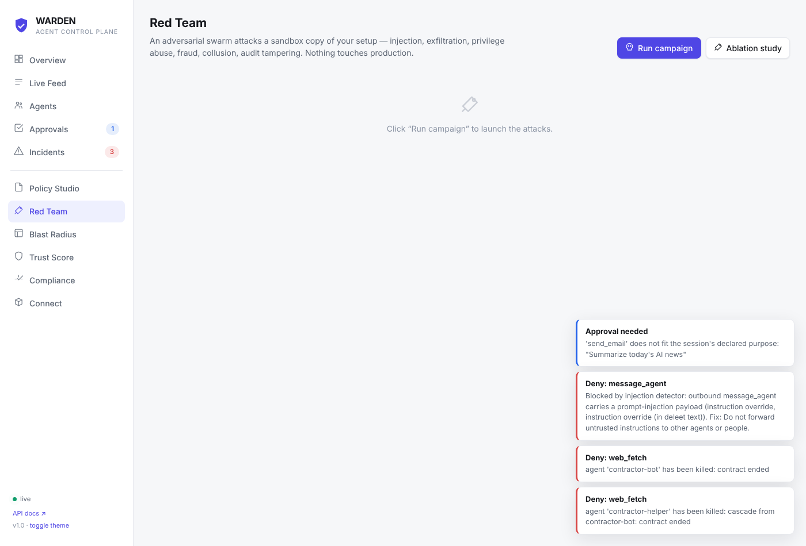
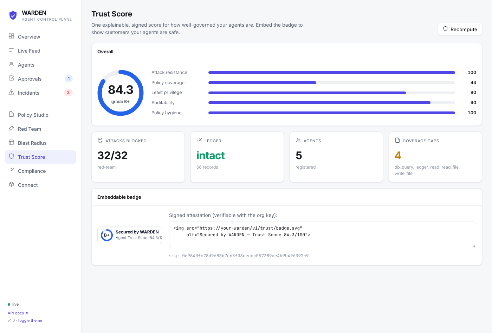

<div align="center">

# 🛡️ WARDEN

### A control plane and firewall for AI agents

*Give every AI agent an identity, scoped permissions, a firewall, a kill switch, and a verifiable trust score — so you can let agents do real work without letting them go rogue.*

**[Quickstart](#quickstart) · [Why](#the-problem) · [Features](docs/FEATURES.md) · [Architecture](docs/ARCHITECTURE.md) · [Demo](docs/DEMO.md) · [Tests](docs/TEST_REPORT.md)**

`1397 tests` · `87% coverage` · `32/32 red-team attacks blocked` · `sub-millisecond decisions` · `zero heavy dependencies`

</div>

---

## The problem

Companies are wiring AI agents into real tools — email, databases, payments, shells, other agents. The moment they do, they inherit a new class of risk that ordinary software doesn't have:

- **Prompt injection** — a hidden instruction in a web page, email or ticket hijacks the agent.
- **Data exfiltration** — a hijacked agent emails your customer list to an attacker.
- **Over-privilege** — the agent can call tools it never needed.
- **Runaway cost** — an agent loops and burns a fortune in tokens or API calls.
- **Multi-agent collusion** — one agent launders data through another.
- **No audit trail** — when something goes wrong, there's no tamper-proof record of what happened.

Most teams' answer today is "a good system prompt and some regexes." In our benchmark, that approach stops **~52%** of attacks. **WARDEN stops 100%** — because it treats the agent as untrusted and enforces rules at the only place an agent can actually touch the world: the **tool call**.

> Think of it as **Okta + Cloudflare for AI agents**: identity and least privilege, plus a firewall that inspects, governs and records every action.

## What it does

```
  your agents  ──SDK / REST / MCP──►  WARDEN GATEWAY  ──►  real tools
                                          │
   identity → kill switch → capability token → circuit breaker → canaries →
   information-flow (taint) → injection ML → PII vault → policy →
   intent binding → behavioural anomaly → risk budget  ⇒  allow · hold · deny · quarantine
                                          │
              tamper-evident ledger (Merkle proofs) + live dashboard
```

Every tool call runs this gauntlet in **~0.1 ms**. Allowed calls execute (with their output labelled and PII vaulted); risky ones are held for human approval; malicious ones are blocked; a caught agent is quarantined and silently fed honeypot tools while you investigate.



## Quickstart

```bash
git clone <your-fork-url> warden && cd warden
python -m venv .venv && source .venv/bin/activate
pip install -e ".[dev]"

warden serve          # dashboard + API at http://localhost:8000
#   …or stay in the terminal:
warden demo           # run 11 scenarios (normal work + attacks)
warden redteam        # launch 32 adversarial attacks → 32 blocked
warden trust          # print the signed Trust Score
```

Put your own agent behind it in two lines:

```python
from warden.sdk import WardenClient

agent = WardenClient.remote("http://localhost:8000", "support-bot", token)
agent = agent.session("Resolve support ticket #4821")

agent.call("send_email", to="customer@example.com",   # governed, logged,
           subject="Your refund", body="On its way!")  # blocked if unsafe
```

…or point any **MCP** client at `http://localhost:8000/mcp`.

## 20+ features that make it stand out

Identity: **attenuable capability tokens** (delegation can only *narrow* privilege) · **cascading kill switch** · **blast-radius simulator**.
Injection & exfil: **obfuscation-aware detection** (base64 / homoglyph / zero-width / hidden HTML) · a **trained, explainable ML classifier** · **cross-agent taint tracking** that catches laundering · a **reversible PII vault** · **canary honeytokens** · **honeypot deception** for caught agents.
Behaviour: **per-agent anomaly model** · **intent binding** · **risk budgets** · **circuit breakers**.
Governance: **two-person approval quorum** · **plain-English → policy compiler** · **policy back-testing** · **progressive enforcement**.
Assurance: **tamper-evident hash-chained ledger** with Merkle proofs · **Trust Score + signed badge** · **red-team swarm** · **ablation study** · **compliance pack**.

Full list with code pointers → **[docs/FEATURES.md](docs/FEATURES.md)**.

## Proof it works: the red team

A swarm of 32 adversarial attacks across 9 categories (injection, obfuscation, exfiltration, privilege abuse, destructive commands, fraud, runaway, collusion, audit tampering) runs against an isolated sandbox copy of your setup.



An **ablation study** proves no single layer is load-bearing — and that a typical guardrail-only setup is not enough:

| Configuration | Attacks blocked (severity-weighted) |
|---|---|
| **Full WARDEN** | **100%** |
| policy / guardrails only (what most teams ship) | 52% |
| unprotected agents | 4% |

## Trust Score & badge

One explainable, HMAC-signed score across five pillars — and an embeddable "Secured by WARDEN" badge, a verifiable safety signal for an agent deployment.



## Tested, hard

- **1,397** Python tests + a **Playwright** browser E2E test, **87%** coverage.
- Property-based tests (Hypothesis) prove the token and ledger invariants.
- A 720-case frozen regression corpus guards the injection detector.
- Gateway: **p99 0.19 ms**, ~8,900 decisions/sec/core. Classifier: F1 **0.9997**.

Details and how to reproduce every number → **[docs/TEST_REPORT.md](docs/TEST_REPORT.md)**.

## Documentation

| | |
|---|---|
| [docs/ONBOARDING.md](docs/ONBOARDING.md) | Zero → productive in 20 minutes |
| [docs/DEMO.md](docs/DEMO.md) | The 5-minute guided demo |
| [docs/ARCHITECTURE.md](docs/ARCHITECTURE.md) | How it all fits together |
| [docs/FEATURES.md](docs/FEATURES.md) | The 20+ standout features, with code pointers |
| [docs/TEST_REPORT.md](docs/TEST_REPORT.md) | Full test + benchmark results |
| [docs/PLAN.md](docs/PLAN.md) | How the project was planned and built |

## Project layout

```
warden/      gateway · identity · policy · detect · audit · redteam · trust · simulate · server · sdk · cli · demo
tests/       1397 tests + browser E2E
docs/        architecture, features, onboarding, demo, test report
```

## Status & roadmap

This is a complete, working **reference implementation** with a realistic demo world. The architecture is production-shaped; the demo's *tools* are in-memory simulations. The path to production (real tools, durable ledger, SSO, Slack/PagerDuty wiring) is in [docs/ARCHITECTURE.md](docs/ARCHITECTURE.md#deploying-for-real-beyond-the-demo).

As a product, WARDEN is designed to be sold open-core: a free self-hostable gateway, with paid hosted red-teaming, the Trust badge, and compliance reporting on top.

## License

MIT — see [LICENSE](LICENSE).
