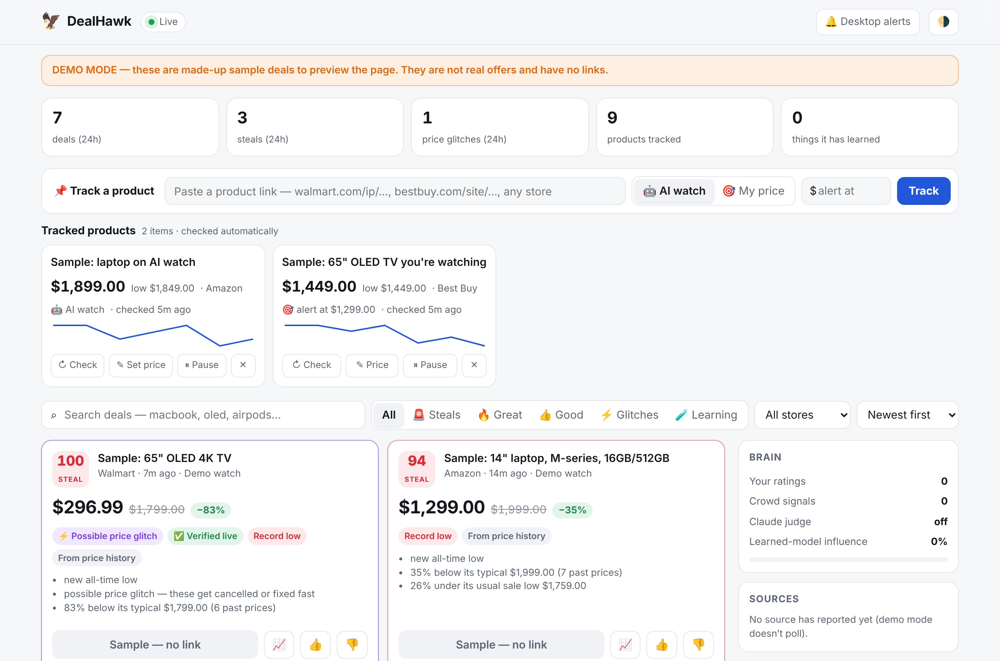

# 🦅 DealHawk

**A 24/7 agent that catches the once-a-year prices — flash drops, clearance dumps and outright price glitches — and pings you on WhatsApp before they're gone.**

It ignores everyday "20% off" noise. It alerts you when something is priced far below what *that exact product* normally sells for: the $2,000 MacBook Pro that drops to $1,300 for an hour, or the $100 item that never goes below $60 suddenly listed at $20.

```
 sources (every 2–15 min)                    brain                                   you
 ───────────────────────                     ─────                                   ───
 Slickdeals · Reddit deal subs ─┐   formula: price vs the item's OWN history ─┐
 Walmart · Target · Amazon      │   (record low? σ-drop? below usual sale?)   │   WhatsApp / ntfy /
 Best Buy · Costco · Home Depot ├─► Claude: market knowledge, fake-deal check ├─► Telegram / Discord
 Newegg · B&H · 12 more         │   learned model: your 👍/👎 + crowd signals │   with the link
 Keepa (Amazon) · Shopify · URLs┘   glitch? → re-check the live price NOW  ───┘   + 👍/👎 to train it
```

## How it decides what's a steal

**1. The Steal Score (0–100)** compares the price with the item's own price history, not the retailer's "list price" (`dealhawk/scoring.py`):

| | what it measures |
|---|---|
| **novelty** | how far below the item's *usual sale low* (10th percentile) |
| **rarity** | robust z-score against its typical price: is this drop out of character for the product? |
| **depth** | plain % off typical. It gates tiny blips and rewards huge cuts |

```
$ dealhawk score 20 --history 100,100,95,100,60,100,98,62,100
score 100/100 → steal (basis: history)  ⚡ glitch suspect
$ dealhawk score 80 --history 100,100,95,100,60,100,98,62,100
score 25/100 → meh                      ← the "20% off!" banner you should ignore
```

With no history yet, it falls back to source stats (Keepa's 90-day average), then to the seller's "was" price (trusted less, because those get inflated), then to signals ("price mistake" tags, upvote velocity).

**2. Claude as a judge** (optional, `dealhawk/llm.py`). This covers what a formula can't do. Claude knows roughly what a product sells for, so it can rate items with zero history (a new MacBook post at $1,299 gets flagged right away). It also catches "MacBook Pro" listings that are really a $15 case. Requests are batched (10 offers per call), cached, capped per hour, use structured JSON output, and have server-side refusal fallback enabled.

**3. A model that learns you** (`dealhawk/learner.py`, `brain.py`). This is online logistic regression over deal features: discount, record low, retailer, category, price band, title words, Claude's verdict, crowd heat. It trains on:
- your **👍 / 👎** (alert buttons, a WhatsApp reply like `good 123`, or `dealhawk review`)
- **clicks** on "Open deal" (weak signal)
- **the crowd:** posts that get upvoted fast or sell out within hours count as positives, and posts nobody cares about count as negatives. So it keeps learning without you.

It starts out agreeing with the formula and gains influence as labels add up (up to 80%). Up to 6 times a day it **explores**: it sends a "🧪 good deal?" alert just below your threshold to learn your taste faster. `dealhawk brain` shows what it has learned.

**4. Glitch verification** (`dealhawk/verify.py`). When something looks like a pricing error, DealHawk re-reads the live price from the retailer's API or product page right away:

| result | action |
|---|---|
| ✅ still live | **STEAL**, sent at once, even during quiet hours |
| ❌ already fixed | dropped |
| ⚠️ blocked | sent anyway, marked unverified |

> ⚖️ In the US, retailers generally **don't have to honor pricing errors**. Amazon, Walmart, Target and Best Buy can cancel those orders under their terms of sale, and often do. Verification means the price is live *right now*, so you can check out before it's fixed. Some glitches ship, some get cancelled, and if yours is cancelled you're refunded.

## Where it looks

| source | covers | notes |
|---|---|---|
| `rss` presets: Slickdeals frontpage / popular / search, Reddit subs | **every retailer** | Thousands of hunters post Walmart, Target and Amazon glitches within minutes. This is the most reliable "instant" channel. |
| `reddit` JSON | r/buildapcsales, r/deals, r/AppleDeals… | Upvote velocity feeds the score; falls back to RSS if blocked |
| `retailer` | Walmart, Target, Amazon, Best Buy, Costco, Home Depot, Lowe's, Newegg, B&H, Micro Center, Sam's Club, Macy's, Kohl's, Dell, Apple Refurb, eBay, GameStop, Wayfair, **any store** (`other` + URLs) | Deal, clearance and search pages read by a generic harvester (JSON-LD, `__NEXT_DATA__`, embedded state, Amazon HTML). `browser: true` renders JS-heavy pages. |
| `keepa` | Amazon | Paid API; tracks Amazon's own price history. The best Amazon source. |
| `bestbuy` | Best Buy | Official free API, exact live prices |
| `shopify` | any Shopify store | Public `products.json`, builds true per-variant history |
| `watch` | specific product URLs | Builds price history for the exact items you care about |

> 🛡️ **Big-box sites fight bots.** Walmart, Target and Amazon use Akamai, PerimeterX and captchas, and their terms restrict automated access. DealHawk keeps per-site gaps between requests, backs off when blocked, and treats a captcha page as a failure. Keep intervals modest and the page list short, and rely on the community feeds, Keepa and official APIs for speed. The preset URLs are best-effort: check each one with `dealhawk once --source <name> -v`.

## Track any product by its link

Paste a product link in the dashboard's **📌 Track a product** bar (or run `dealhawk track add <url>`) and choose a mode:

| mode | alerts you when |
|---|---|
| **🎯 My price** | the price is at or below the price you set (and again if it drops ≥5% further) |
| **🤖 AI watch** | it hits its **lowest price since you started tracking** (after a few checks, so the first readings don't count), or the Steal Score / Claude rate it a **great or steal** deal |

In both modes a suspected price glitch is re-verified live and sent at once. Each tracked item shows its current price, lowest price, a price chart, when it was last checked, and any problem reading it (for example "the store blocked the request (bot protection)"). It also has Check now / change price / pause / remove buttons.

Prices are read from the store's structured data (JSON-LD, Next.js state, Shopify JSON, Amazon's HTML), with a headless browser as a fallback for JS-heavy pages (`pip install playwright && playwright install chromium`). Only public `http(s)` links are accepted.

```
dealhawk track add https://www.bestbuy.com/site/…/6565837.p --target 799   # 🎯 alert at $799
dealhawk track add https://www.walmart.com/ip/…/5129348702                 # 🤖 AI watch
dealhawk track list | check | rm 3
```

## Live dashboard



<sub>Screenshot from `dealhawk serve --demo`: sample data, not real deals. Also in [dark](docs/dashboard-dark.png) and on a [phone](docs/dashboard-phone.png).</sub>

`dealhawk run` hunts deals **and** serves a live page at **http://localhost:8686**. New deals appear on it the moment they're found, pushed over Server-Sent Events, with no refresh needed.

- Filter by Steals / Great / Good / ⚡ Glitches / 🧪 Learning, by store, or by search text. Sort by newest, score or % off.
- 📈 opens the product's price-history chart. 👍 / 👎 trains the model.
- 🔔 **Desktop alerts** pop up a browser notification for steals while the tab is open, with no WhatsApp setup needed.
- A sources panel shows each source's health (when it last ran, how many items it saw, blocked or erroring).
- Works on a phone, in light and dark themes, and fully offline (one self-contained page, no CDNs).

```bash
dealhawk serve --demo     # preview with clearly-labelled SAMPLE data (no links, DEMO banner)
dealhawk run              # the real thing: poll sources + dashboard
dealhawk serve            # dashboard only, over an existing dealhawk.db
```

**Hosting it** so you can open it from anywhere: set `web.host: 0.0.0.0` and `web.password`. It uses HTTP Basic auth, and DealHawk refuses to bind to a public address without a password. With Docker: `cd deploy && docker compose up -d`, then put HTTPS in front with Caddy or a Cloudflare Tunnel, or keep it private with Tailscale.

## Quickstart

```bash
cd dealhawk
pip install -e ".[claude]"         # [claude] only needed for the Claude judge
dealhawk init                      # writes dealhawk.yaml — edit watches + notify
dealhawk score 1300 --history 1999,1999,1899,1999,1799,1699,1999   # play with the scorer
dealhawk test-notify               # sample alert to every channel
dealhawk once --dry-run -v         # one pass, print instead of sending
dealhawk run                       # 24/7
```

### WhatsApp setup (pick one)

| provider | setup | replies train the model? |
|---|---|---|
| **CallMeBot** | 2 min, free: follow callmebot.com's WhatsApp instructions to get an `apikey` | no (outbound only) |
| **Twilio** | free sandbox: join it from your phone, set `TWILIO_*` env vars | yes |
| **Meta Cloud API** | official: create a WhatsApp app, get `phone_number_id` + `access_token` | yes |

To reply-to-train, set `feedback.public_url` and `feedback.secret`, run `dealhawk webhooks`, and paste the printed URL into Twilio or Meta. Every alert then ends with *Reply "good 123" or "bad 123"*.

WhatsApp rule: Twilio and Meta can only send free-form messages within 24 h of your last message to the bot. Message it once a day, or set an approved `template` (Meta).

### Everyday commands

```
dealhawk serve [--demo]            the live dashboard (also started by `dealhawk run`)
dealhawk deals [--hours 24] [-v]   recent deals in the terminal (🔔 = alerted, 🧪 = exploration)
dealhawk review                    rate recent deals y/n — fastest way to teach it
dealhawk feedback 123 good         rate one deal
dealhawk brain [--retrain]         what it has learned
dealhawk sources                   presets, retailers, stats
```

## Running it 24/7

Glitches often last minutes, so **speed matters more than anything**. Pick a host that runs continuously:

| where | cadence | how |
|---|---|---|
| **Always-on box** (Oracle Cloud free VM, $4 VPS, Raspberry Pi, home server) | every 2 min | `deploy/docker-compose.yml` or `deploy/dealhawk.service` |
| **Claude Code cloud scheduled task** | hourly (default minimum) | `deploy/claude-cloud/`, see below |

### On Claude's cloud

`deploy/claude-cloud/run.sh` does one full pass. Because each cloud session starts in a fresh container, it restores and saves the database (price history, sent alerts, learned model) on a `dealhawk-state` git branch. To set it up:

1. **Allow the hosts** in the cloud environment's network settings (environment menu → Edit → Network access → Allowed domains): `slickdeals.net`, `www.reddit.com`, `api.callmebot.com` / `api.twilio.com` / `graph.facebook.com`, `api.anthropic.com`, plus the retailers and APIs you enable (`www.walmart.com`, `api.keepa.com`, `api.bestbuy.com`, …). [Docs](https://code.claude.com/docs/en/cloud-environments#network-access)
2. **Add your secrets** (WhatsApp, Keepa, `ANTHROPIC_API_KEY`) as environment variables in the same settings.
3. **Create a scheduled task** that runs `bash dealhawk/deploy/claude-cloud/run.sh` every hour.

An hourly run *will* miss short glitches, so use it as a complement to an always-on host, not a replacement.

## Project layout

```
dealhawk/
  scoring.py      Steal Score from price history          learner.py  online model of your taste
  llm.py          Claude judge (batched, cached, capped)   brain.py    combines formula + Claude + learner
  verify.py       live re-check of suspected glitches      engine.py   score → match → verify → notify
  matching.py     your watches (keywords, price caps…)     scheduler.py 24/7 loop, per-source backoff
  store.py        SQLite: history, alerts, labels, model   feedback.py 👍/👎 + WhatsApp reply webhooks
  web.py + web/   live dashboard, JSON API, SSE stream     demo.py     labelled sample data for --demo
  sources/        rss · reddit · retailer (+ harvest) · keepa · bestbuy · shopify · watch
  notify/         whatsapp · ntfy · telegram · discord · pushover · console
tests/            every source parsed from fixtures; network blocked in tests
```

`pytest` runs the whole suite offline in a few seconds.
